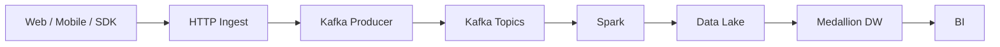

# Click Stream To BI

back to all DE System Design : [[DE System Design]]

## Flow

## Data To Kafka

### summary

* Web page sends event data to intermediate layer using **navigator.sendBeacon() or standard fetch() / POST calls**
* Intermediate layer send events to Kafka Topic
  * Snowplow, Divolte, or custom Go/Node.js microservices <-> [Kafka REST Proxy](#kafka-rest-proxy) <-> Kafka Topic

### Client-Side Event Capture

* A lightweight JavaScript tracker or mobile SDK attaches listeners to user interactions (page views, button clicks, form submissions, scroll depth).
* When an interaction occurs, the script builds a structured JSON payload containing event metadata:

  * user_id / session_id
  * event_type (e.g., button_click, page_view)
  * timestamp (UTC)
  * url / screen_name
  * device_info (User-Agent, OS, screen resolution)
* The browser dispatches these events asynchronously using navigator.sendBeacon() or standard fetch() / POST calls to avoid blocking UI rendering or page navigation.

### Ingestion & Gateway Tier (Producer)

* Web browsers and mobile apps cannot directly connect to raw Kafka TCP ports due to network firewalls, socket overhead, and security constraints.
* Events hit an intermediary ingestion tier:

  * **Lightweight Reverse Proxies / Collectors:** Open-source collectors like Snowplow, Divolte, or custom Go/Node.js microservices.
    
  * **Kafka REST Proxy:** Directly exposes standard HTTP endpoints (e.g., Confluent REST Proxy) that convert incoming HTTP POST requests into Kafka produce requests.
  * **Serverless / Cloud Endpoints:** AWS API Gateway, Cloudflare Workers, or Nginx with Lua Kafka modules.
* This tier validates the schema, sanitizes the payload, handles rate limiting, and authenticates requests.

### Producing To Kafka Topic

* The ingestion service runs the **Kafka Producer Client** (`KafkaProducer`), which batches records and pushes them over TCP to the Kafka brokers.
* **Keying and Partitioning:**

  * A record key (typically `user_id` or `session_id`) is attached to each event.
  * Kafka hashes the key to assign the event to a specific topic partition. This guarantees that all click events for a specific user are consumed strictly in chronological order.
* **Buffering & Compression:**

  * Producers configure `linger.ms` and `batch.size` to group thousands of micro-clicks together.
  * Payloads are compressed using algorithms like Snappy, LZ4, or zstd before being written to disk, minimizing bandwidth and disk I/O.
* **Serialization:**

  * While data arrives over HTTP as JSON, producers typically serialize payloads into  **Apache Avro** , **Protobuf** , or keep them as compact JSON strings, often integrating with a **Schema Registry** to enforce contract rules.
* **Storage & Downstream Fan-Out**

  * Kafka commits the messages to an append-only write-ahead log across topic partitions.
  * Downstream consumers independently process the clickstream without impacting ingestion throughput:
    * **Real-time processing engines:** Apache Flink or Spark Streaming compute rolling metrics, detect fraud, or generate real-time recommendations.
    * **Batch/Storage Connectors:** Kafka Connect (with S3, GCS, or Snowflake sinks) writes raw clickstream files for historical analytics and data warehousing.

### Why Kafka?

* Can process 1L events per second
* Kakfa Broker stores the events in it's topic as buffer for specified period of time.

## Event Inside Kafka

### Network Ingestion via Java NIO Socket Channels

* Kafka's Nerwork Layer is build using [Java NIO](https://www.geeksforgeeks.org/java/introduction-to-java-nio-with-examples/)
* Broker with single Acceptor Thread Listening to configured TCP port
  - Event Arrives
  - raw byte stream
  - Kafka Converts into `ProduceRequest Object`
  - Once Parsed processor move the data to `shared in-memory request queue`

### Request Handling & Verification (I/O Threads)

- `KafkaRequestHandler` worker pull the data from queue and verify [ACL](https://www.fortinet.com/resources/cyberglossary/network-access-control-list) Like Validate producer identity and check it has write permission to the target topic and partition.
- If not confirms throws an `NOT_LEADER_OR_FOLLOWER` error
- If confirmed : Transaction & Idempotency De-duplication
  * Every batch will have a PID and increase monotinically (e.g., PID1, PID2, ..)
  * It checks Last 5 sequence If duplicate found drops it, if order is missing then throws `OUT_OF_ORDER_SEQUENCE_NUMBER` error

### Writing to the Append-Only Commit Log

- Offset Assignment using its unique, sequential offset
- OS Page Cache Write(Zero Copy Append): Instead of random I/O to disk, It Writes in **Linux OS page Cache** using `pwrite/writev` to active active segment file (.log)
- **Index Updates**
  - **For every** N  bytes written (controlled by `index.interval.bytes`), the broker writes corresponding entries to two memory-mapped auxiliary files:
    - **Offset Index (`.index`):** Maps logical offsets to byte positions in the `.log` file, enabling fast binary lookups.
    - **Time Index (`.timeindex`):** Maps timestamps to offsets for time-based searches and log retention pruning.
